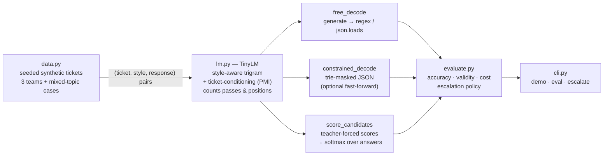

# llm-output-contracts-lab

A small, runnable comparison of the three ways to get a **fixed-choice decision** out of a language model, all driven by the *same* next-token distribution so the only thing that changes is the output contract:

| Contract | What the model does | What the application receives |
| --- | --- | --- |
| **Free decoding** | Generates text token by token until it stops | A string you must parse ("…this ticket should go to billing.") |
| **Structured output** (grammar-constrained) | Generates JSON token by token; a grammar masks every token that would break the schema | Valid JSON, guaranteed: `{"team": "billing"}` |
| **Candidate scoring** | Is given the allowed answers up front and scores each one in a single teacher-forced pass; nothing is generated | A probability for every allowed answer: `billing 0.94, technical support 0.03, account access 0.03` |

## Why

Many LLM calls in production are not writing tasks. Routing, classification, policy checks and ranking already have a known set of valid answers; the only question is which one fits the input. Take a support ticket, *"I was charged twice for the same subscription."*, that must go to billing, technical support or account access.

- With **free decoding** the model writes a sentence and the application recovers the decision with a parser, which can fail when the text names zero or two teams.
- **Structured output** guarantees the shape, but the model still decodes the JSON one token at a time, paying a sequential model call for `{`, `"`, `team`, `:`... The schema is the right tool when the values are *unknown* beforehand (extracted fields, tool arguments, nested objects).
- **Candidate scoring**, the approach behind "System 1" scoring models such as Jev, skips generation entirely. The query, the input and the allowed answers go in together; the model returns a distribution over the answers. It can't write an explanation or invent a field value, but for a fixed choice it returns exactly the decision, plus a confidence the application can act on.

This lab makes those differences measurable: decision accuracy, how often the application gets a usable answer, sequential forward passes, tokens pushed through the model, and whether you get a probability distribution at all.

## Architecture



## Code map

```
llm-output-contracts-lab/
├── contracts/
│   ├── data.py         Seeded synthetic support tickets for three teams, plus "mixed" tickets that combine two
│   │                   teams' topics (the genuinely ambiguous cases). Response templates for the three styles the
│   │                   model is trained on: prose sentences, JSON, and a bare label.
│   ├── lm.py           TinyLM: the model all three contracts share. next_logprobs() is one decoding step;
│   │                   score_sequences() is one batched teacher-forced pass over candidate answers. Both count
│   │                   forward passes (sequential model calls) and positions (tokens processed).
│   ├── strategies.py   The three contracts. free_decode() + parse_label()/detok_json(); constrained_decode()
│   │                   walks a trie of every schema-valid token sequence and masks the rest (fast_forward skips
│   │                   the model when only one token is legal); score_candidates() returns a distribution.
│   ├── evaluate.py     Runs every contract over 150 held-out tickets and tabulates accuracy (overall / clean /
│   │                   mixed), valid-output rate, passes and positions; escalation_policy() uses scored
│   │                   probabilities to auto-route confident tickets and escalate the rest.
│   └── __init__.py     Public API.
├── cli.py              `demo` (one ticket through every contract), `eval` (the comparison table, greedy or
│                       sampled), `escalate` (threshold policy on the scored probabilities).
├── tests/
│   └── test_contracts.py  14 tests: normalization and cost counting, parsing edge cases, constrained output always
│                          valid even under sampling, free decoding able to break its contract, fast-forward giving
│                          identical answers with fewer passes, scoring distributions, lower confidence on mixed
│                          tickets, escalation trade-off.
└── requirements.txt    numpy (+ pytest for the tests).
```

### About the model

To compare contracts without a GPU, every strategy runs on `TinyLM`, a deliberately transparent conditional language model:

```
logit(w) = log P_ngram(w | output style, previous two response tokens)    # format and fluency
         + λ · mean over ticket words c of PMI(c, w)                       # conditioning on the ticket
```

The n-gram part learns the response templates; the PMI part learns that "charged" and "refund" push probability toward `billing`. It is not a transformer, but it exposes the same interface the strategies need from one (a next-token distribution given a prompt and a prefix, and teacher-forced sequence scores), and its cost counters follow transformer accounting: decoding pays one sequential pass per generated token, scoring pays one batched pass for all candidates.

## Run it

```bash
python -m venv .venv && source .venv/bin/activate   # optional
pip install -r requirements.txt

python cli.py demo                                   # the double-charge ticket through all three contracts
python cli.py demo --ticket "my login link has expired"
python cli.py eval                                   # greedy decoding, 150 held-out tickets
python cli.py eval --temperature 1.0                 # with sampling
python cli.py escalate --threshold 0.7
python -m pytest -q
```

Everything runs on CPU in about a second. Requires Python 3.10+.

## Results

**One ticket** (`python cli.py demo`):

| Contract | Output | Sequential passes | Positions |
| --- | --- | --- | --- |
| Free decoding | `based on the customer's query , this ticket should go to billing .` | 14 | 22 |
| Constrained JSON | `{"team":"billing"}` | 10 | 18 |
| Constrained JSON + fast-forward | `{"team":"billing"}` | 1 | 15 |
| Candidate scoring | `billing → 0.94, technical support → 0.03, account access → 0.03` | 1 | 17 |

**150 held-out tickets, greedy** (`python cli.py eval`; 41 tickets mix two teams' topics, "acc" counts the primary team):

| Contract | Acc | Clean | Mixed | Valid | Passes | Distribution |
| --- | --- | --- | --- | --- | --- | --- |
| Free decode → prose → regex | 87% | 100% | 51% | 100% | 11.8 | no |
| Free decode → JSON → `json.loads` | 87% | 100% | 51% | 100% | 10.7 | no |
| Grammar-constrained JSON | 87% | 100% | 51% | 100% | 10.7 | no |
| Constrained JSON + fast-forward | 87% | 100% | 51% | 100% | 1.0 | no |
| Candidate scoring | 86% | 100% | 49% | 100% | 1.0 | **yes** |

With greedy decoding the *decisions* barely differ: they all come from the same model. What differs is the contract. Free decoding and unconstrained JSON need ~11 sequential model calls to produce a decision that still has to be parsed.

**Same, sampled at temperature 1.0** (`python cli.py eval --temperature 1.0`):

| Contract | Acc | Valid |
| --- | --- | --- |
| Free decode → prose → regex | 62% | 84% |
| Free decode → JSON → `json.loads` | 20% | 35% |
| Grammar-constrained JSON | 67% | 100% |
| Candidate scoring | 86% | 100% |

The tiny model is a much worse sampler than a real LLM, so these validity numbers exaggerate the failure rate. The point is qualitative: only the free-text contracts *can* hand the application something unusable, and constrained decoding guarantees the shape but still inherits sampling noise in the value. Candidate scoring is deterministic.

**What the distribution buys you** (`python cli.py escalate`):

| Threshold | Auto-routed | Accuracy when auto-routed | Escalated (of which mixed-topic) |
| --- | --- | --- | --- |
| 0.50 | 140 / 150 | 88% | 10 (10) |
| 0.70 | 99 / 150 | 99% | 51 (40) |
| 0.80 | 69 / 150 | 100% | 81 (41) |

The ambiguous tickets are exactly the ones the scores are unsure about, so a confidence threshold separates "route automatically" from "ask a human". Generated text gives you no such number without extra work.

## Things worth noticing

- **Fast-forward narrows the gap, but not to scoring.** Structured-generation engines skip the model call for tokens the grammar already determines (`{`, `"team"`, `:`). For a fixed choice that leaves one real decision step, so passes drop to 1. But that step only looks at the *first* token that distinguishes the answers, and you still get a single path rather than a scored distribution over complete answers.
- **Length matters when scoring.** `billing` is one token and `account access` is two. `score_candidates(..., length_normalize=True)` divides by token count; compare both on your own label sets.
- **Choose by output contract, not by habit.** Need new text → free decoding. Need unknown values in a guaranteed shape → structured output. The valid answers are already known → candidate scoring.

## Using a real model

The strategies only call `lm.next_logprobs(ticket, style, prefix)`, `lm.score_sequences(ticket, style, seqs)`, `lm.vocab`, `lm.token_id()` and the two counters. To try them on a real causal LM, implement those methods with your inference library (logits from the last position for decoding, summed token log-probs over each candidate for scoring) and pass that object in place of `TinyLM`. For production-grade constrained decoding see engines such as [Outlines](https://github.com/dottxt-ai/outlines) and [XGrammar](https://github.com/mlc-ai/xgrammar), which compile JSON schemas and grammars into the same kind of token masks used here.
